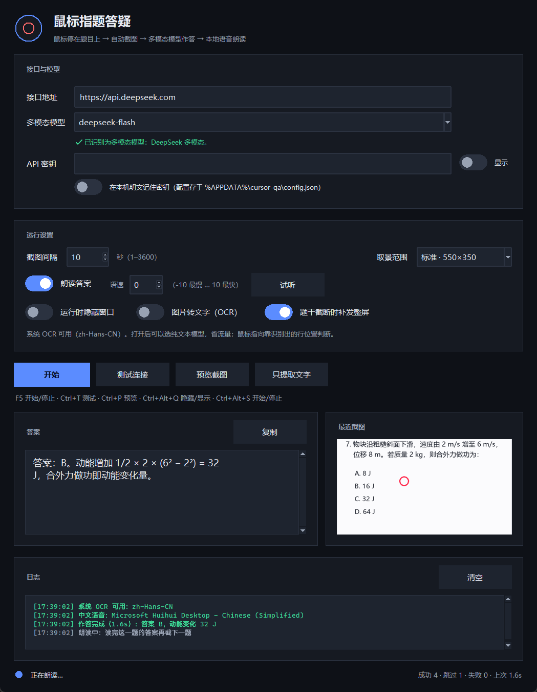
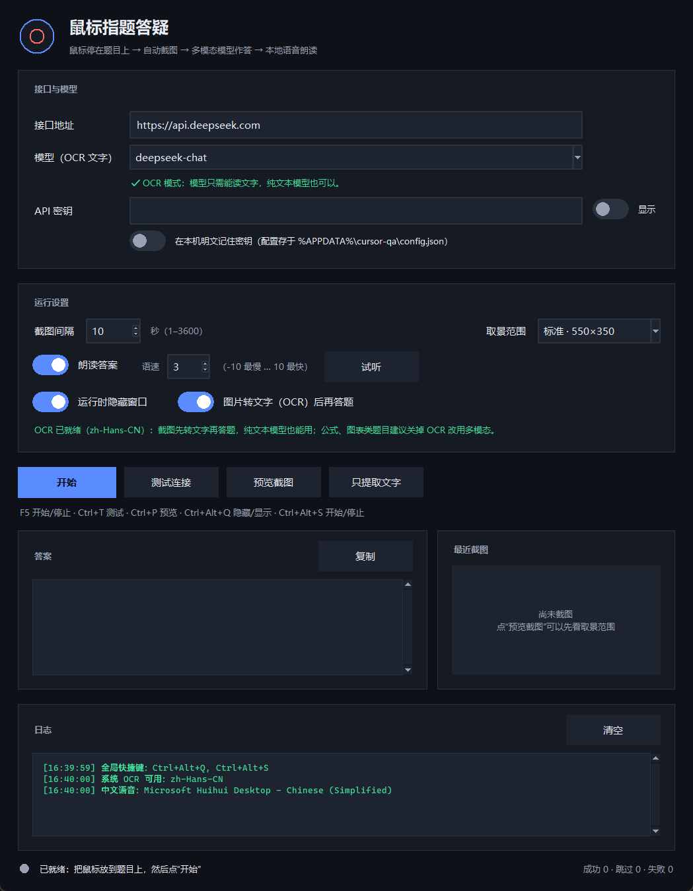

# sightqa · 鼠标指题答疑

> 把鼠标停在题目上，自动截取光标周围的画面，交给**多模态大模型**（或先转文字再交给任意模型）作答，并用 Windows 自带语音念出来。



<p align="left">
  
  
  
  
  <a href="https://github.com/ira0529/sightqa/actions/workflows/ci.yml"></a>
</p>

刷题时最烦的不是不会，而是“看题 → 截图 → 粘贴 → 等回复”这一套动作。这个工具把它们合成一件事：鼠标指哪，答案念哪。

---

## 功能

| | |
|---|---|
| 🎯 **光标取景** | 以鼠标为中心截取 550×350（可调），红圈标出指向位置；靠边自动收拢，多显示器按虚拟桌面坐标计算 |
| 🧠 **模型守卫** | 多模态模式下识别模型是否读图，纯文本模型会弹窗拦截；「测试连接」真的发一张图，回 `OK` 才算通过 |
| 🔤 **图片转文字（可选）** | 用 Windows 自带 OCR 把截图转成文字再答题：纯文本模型就能用、省流量；鼠标指向靠识别出的**行位置**判断，替你标出 `▶` |
| 🗣 **语速可调 + 试听** | SAPI 语速 −10…10，点「试听」立刻听效果，设置会记住 |
| ⏳ **读完再问下一题** | 朗读期间不截图、不发请求；答案念完才继续，不会出现「上一题还在念、下一题已经答完」 |
| 🫥 **运行时可隐藏窗口** | 勾上后开始运行即隐藏，不挡题目；`Ctrl+Alt+Q` 随时唤回，`Ctrl+Alt+S` 开始/停止 |
| 🔁 **自动去重** | 画面 16×10 指纹几乎没变就跳过（含时钟、光标闪烁），不烧额度 |
| 🩹 **健壮请求** | 429 / 5xx / 超时指数退避重试；HTTP 错误翻译成能照着改的中文提示；接口风格自动识别 |
| 🪟 **深色 HiDPI 界面** | 自定义 ttk 主题、胶囊开关、状态栏、请求统计、截图预览、分级日志 |
| 🔐 **隐私友好** | 密钥默认不落盘；截图只发给你自己配置的接口；OCR 全程本地 |

## 快速开始

1. 安装 [Python 3.10+](https://www.python.org/downloads/windows/)（勾选 *Add python.exe to PATH*）
2. 安装依赖：

   ```powershell
   pip install -r requirements.txt     # 或者：pip install .（装完可直接运行 sightqa）
   ```

3. 准备 API 密钥（推荐环境变量，避免写进任何文件）：

   ```powershell
   setx DEEPSEEK_API_KEY "sk-你的密钥"
   ```

   也可以直接在界面里粘贴。
4. 启动：

   ```powershell
   python cursor_qa.py
   ```

   也可以双击仓库里的 `run.bat`。

## 两种答题模式

**① 多模态模式（默认）**：截图直接发给视觉模型。适合带公式、图表、手写、题面排版复杂的画面。

**② OCR 文字模式**：先本地 OCR 出文字，再把「文字 + 鼠标指向标记」发给模型。适合纯文本题库，能用 `deepseek-chat` 这类纯文本模型，请求更小更快。

打开方式：勾选「图片转文字（OCR）后再答题」，模型名下面会变成「模型（OCR 文字）」，并提示当前模式只要求模型能读文字。



只想拿文字、不想问模型？点 **「只提取文字」**：截图 → OCR → 结果直接进答案栏（可复制），不产生任何接口请求。

> OCR 用的是 Windows 自带的 `Windows.Media.Ocr`（WinRT），不需要装 Tesseract，也不需要联网。缺中文语言包时界面会提示去「设置 → 时间和语言 → 语言」补装。

## ⚠️ 模型必须是多模态的（多模态模式）

这是最容易踩的坑：**纯文本模型不会报错，它会忽略图片、凭空编一个答案**。

所以本项目在三处做了防护：

1. **输入模型名时实时判断**。识别为纯文本模型（`deepseek-chat`、`gpt-3.5-turbo`、`qwen-max`……）会标红；
2. **点击「开始」时二次确认**，让你先换模型，或改用 OCR 模式；
3. **点击「测试连接」实测**。发送一张内置的 128×128 图片，模型回复 `OK` 才判定为可读图。

命令行自测（不打开界面）：

```powershell
python cursor_qa.py --check
# → 正在测试 deepseek-flash @ https://api.deepseek.com（多模态图片模式）
# ✓ 1.6s 返回：OK

python cursor_qa.py --check --ocr --model deepseek-chat
# → 正在测试 deepseek-chat @ https://api.deepseek.com（OCR 文字模式）
```

模型名下拉框里的候选只是示例，**能输入任意模型名**。

## 支持的接口

接口风格按地址自动判断：地址里带 `deepseek` 用 Responses API（`/responses`），其它按 OpenAI 兼容的 `/v1/chat/completions` 发送；也可以直接填完整 URL 强行指定。

| 服务商 | 接口地址 | 模型示例 |
|---|---|---|
| DeepSeek | `https://api.deepseek.com` | `deepseek-flash`（多模态）/ `deepseek-chat`（OCR 模式） |
| OpenAI | `https://api.openai.com/v1` | `gpt-4o` / `gpt-4o-mini` |
| 阿里云百炼 | `https://dashscope.aliyuncs.com/compatible-mode/v1` | `qwen-vl-max` |
| 智谱开放平台 | `https://open.bigmodel.cn/api/paas/v4` | `glm-4v` |
| 任意自建网关 | `https://your-gateway/v1` | 你自己部署的视觉/文本模型 |

> 具体哪些模型对外可用、要不要开通权限，以你账号的实际情况为准；界面里的「测试连接」就是为此准备的。

## 使用

| 操作 | 快捷键 | 说明 |
|---|---|---|
| 开始 / 停止 | `F5` | 开始后按间隔循环截图；停止会立即打断朗读、并把隐藏的窗口叫回来 |
| 全局开始 / 停止 | `Ctrl+Alt+S` | 窗口隐藏时也能用 |
| 全局显示 / 隐藏窗口 | `Ctrl+Alt+Q` | 随时把窗口收起或唤回 |
| 停止 | `Esc` | 同 F5 的停止 |
| 测试连接 | `Ctrl+T` | 验证密钥、地址、模型（多模态模式发图，OCR 模式发文字） |
| 预览截图 | `Ctrl+P` | 只截图、不请求，用来确认取景范围 |

- **截图间隔**：1–3600 秒。开始后先立即截一次，之后按间隔轮询。
- **取景范围**：紧凑 400×260 / 标准 550×350 / 宽屏 760×480；题目很长时选宽屏。
- **画面没变**：会提示「画面没变化，跳过本次截图」，不消耗额度。
- **鼠标在自己窗口上**：不截图，避免界面自己的变化引发无限请求。
- **模型回 `SKIP`**：说明鼠标没指到完整题目，把鼠标移到题干上即可。
- **节奏**：一题一题来——截图 → 作答 → 朗读，**朗读结束**后才重新计时截下一题；朗读花掉的时间算进间隔，所以念得久就不用再等，念得快就补足剩余间隔（保底 0.35 秒）。想更快可以调小间隔、调快语速，或关掉朗读。
- **语速**：−10（最慢）到 10（最快），0 为系统默认；点「试听」马上生效。
- **朗读**：只念答案正文，自动去掉 Markdown 符号；长文本会截断到 600 字；没装中文语音时自动降级为只显示文字。

## 命令行

```text
sightqa [--check] [--model MODEL] [--base-url URL] [--interval SECONDS]
        [--api-key KEY] [--no-voice] [--rate N] [--ocr] [--hide]
        [--config PATH] [--version]

# 等价写法
python cursor_qa.py ...
```

| 参数 | 说明 |
|---|---|
| `--check` | 只做一次连通性测试后退出，不打开界面 |
| `--model` / `--base-url` | 覆盖配置文件里的模型与接口地址 |
| `--interval` | 覆盖截图间隔（1–3600 秒） |
| `--rate` | 覆盖朗读语速（−10…10） |
| `--ocr` | 强制用 OCR 文字模式启动 |
| `--hide` | 启动后隐藏窗口 |
| `--api-key` | 临时指定密钥（更推荐环境变量） |
| `--no-voice` | 关闭朗读 |
| `--config` | 指定配置文件路径 |

## 配置与隐私

- 配置文件：`%APPDATA%\cursor-qa\config.json`（原子写入，损坏或缺失会自动回落到默认值）。
- 保存的内容：接口地址、模型、截图间隔、取景范围、朗读开关与语速、隐藏窗口、OCR 开关。
- 密钥优先级：`CURSOR_QA_API_KEY` > `DEEPSEEK_API_KEY` > `OPENAI_API_KEY` > 配置文件。
- **密钥默认不写盘**；勾选「在本机明文记住密钥」才会存进上面那个 JSON，注意它是明文。
- 截图只发送给你自己填写的接口；OCR 与朗读都在本机完成，不上传、不缓存、不落盘。

## 工作原理

```text
每 N 秒 ──► 鼠标在自己窗口上？ ──是──► 跳过
                 │否
                 ▼
        读取光标位置 ──► 截取虚拟桌面局部 ──► 缩放到 ≤1600px
                 │
        16×10 指纹几乎没变？ ──是──► 跳过（省额度）
                 │否
        ┌────────┴─────────┐
        ▼                  ▼
  多模态模式            OCR 模式
  图片 base64            本地 WinRT OCR
        │                  │  按行 + 光标挑出最近一行，标 ▶
        └────────┬─────────┘
                 ▼
           模型接口（自动识别 /responses 或 /chat/completions）
                 ▼
        显示答案 ──► SAPI 朗读（语速可调，可打断）
                 │
                 └── 朗读期间暂停截图 ──► 念完 → 按剩余间隔排下一次截图
```

## 项目结构

```text
cursor_qa.py            薄启动器（python cursor_qa.py）
cursorqa/cli.py         参数解析、--check 模式、入口（sightqa 命令）
cursorqa/
├── config.py           设置模型、校验、原子持久化（纯函数，可测试）
├── models.py           多模态模型识别 + OCR 模式的宽松规则
├── capture.py          光标取景、DPI、多屏坐标、PNG、画面指纹
├── client.py           Responses / Chat Completions 双协议（图片与纯文字）、重试、错误翻译
├── ocr.py              Windows WinRT OCR：识别、行坐标、指向标记、提示词
├── speech.py           SAPI 语音发现与朗读子进程（含语速）
├── pacing.py           朗读结束后的下一次截图间隔计算（纯函数）
├── hotkey.py           全局快捷键（Ctrl+Alt+Q / Ctrl+Alt+S）
├── powershell.py       PowerShell 调用的公共封装
└── ui.py               Tkinter 界面（深色主题 + HiDPI + 自绘开关）
tests/                  112 个单元测试（含真实 OCR 冒烟与朗读节奏状态机）
tools/                  图标生成、README 截图生成
```

## 常见问题

| 现象 | 原因 | 处理 |
|---|---|---|
| `401` / `403` | 密钥错误、未开通该模型 | 重新复制密钥；确认模型对你账号开放 |
| `429` | 频率或额度受限 | 调大截图间隔；稍等再试（会自动退避重试） |
| `400` 且提示 image / vision | 多模态模式下选到了纯文本模型 | 换模型，或打开「图片转文字」用纯文本模型 |
| `404` | 接口地址或模型名不存在 | 用表格里的地址；或直接填完整 URL |
| 一直返回 `SKIP` | 鼠标没指到题干 | 把鼠标放在题目正文上，或换宽屏取景 |
| OCR 不可用 | 系统没有中文 OCR 语言包 | 设置 → 时间和语言 → 语言，添加中文并安装语言功能 |
| OCR 识别不准 | 公式、手写、复杂排版 | 关掉 OCR，用多模态模式 |
| 没有声音 | 系统缺中文语音 | Windows 设置 → 时间和语言 → 语音 → 添加中文语音 |
| 语速没变化 | 语速在开始运行时生效 | 改完语速点「试听」，或重新点「开始」 |
| 答完一题后隔很久才截下一张 | 正在朗读，朗读结束才会继续（设计如此） | 调快语速 / 调小间隔，或关掉朗读 |
| 朗读卡住导致不再截图 | 音频设备异常 | 超过 180 秒会自动强制继续，并在日志里提示 |
| 隐藏后找不到窗口 | 忘了快捷键 | `Ctrl+Alt+Q`；或按 `Ctrl+Alt+S` 停止，停止会自动显示窗口 |
| 快捷键没反应 | 被其它程序占用 | 日志会写明注册失败，改用界面按钮即可 |
| 截图全黑 | 锁屏 / UAC 安全桌面 | 解锁后使用；这类画面系统不允许抓取 |
| 多显示器位置偏移 | 虚拟桌面原点为负 | 已按虚拟桌面坐标处理；仍异常请提 issue 附显示器布局 |

答案由模型生成，只作学习参考，自己再核对一遍。

## 开发

```powershell
pip install -r requirements.txt
python -m unittest discover -s tests -t . -v   # 112 个测试，除 OCR/截图冒烟外全部离屏
pip install ruff && ruff check .
python tools/make_icon.py                      # 重新生成图标
python tools/screenshot_ui.py                  # 重新生成 README 截图
```

测试覆盖配置解析与迁移、模型识别（含 OCR 模式）、接口选路、两种响应解析、重试与错误归类、取景框边界、画面指纹、OCR 文本清洗与指向行选择、朗读文本与语速、热键生命周期、朗读节奏状态机（暂停 / 续跑 / 卡住兜底）。没有桌面会话或语言包时，截图/OCR 冒烟测试会自动跳过。

## English quick start

A Windows-only desktop helper: hover the cursor over a question; the app periodically captures the area around the pointer and either asks a **vision-capable** model directly, or runs the built-in Windows OCR first and asks any text model. The answer is displayed and read aloud with SAPI (rate adjustable), and the window can hide itself while running.

```powershell
pip install -r requirements.txt
$env:DEEPSEEK_API_KEY = "sk-..."
python cursor_qa.py --check    # verifies key + endpoint (+ vision support in default mode)
python cursor_qa.py            # opens the GUI
python cursor_qa.py --ocr --model deepseek-chat   # OCR mode with a text-only model
```

Hotkeys: `Ctrl+Alt+Q` show/hide window, `Ctrl+Alt+S` start/stop.

## License

[MIT](LICENSE) © 2026 YG
